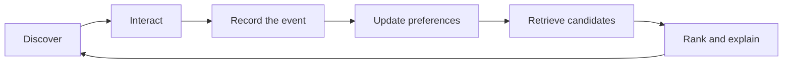
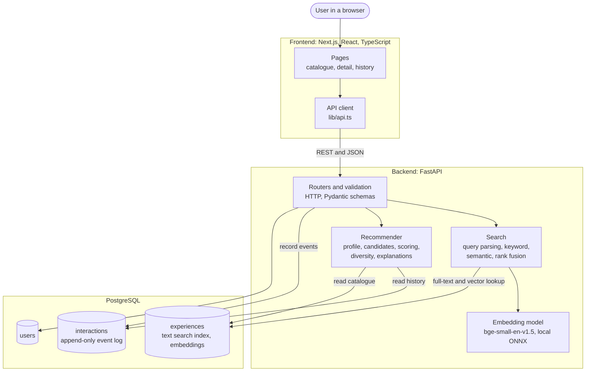
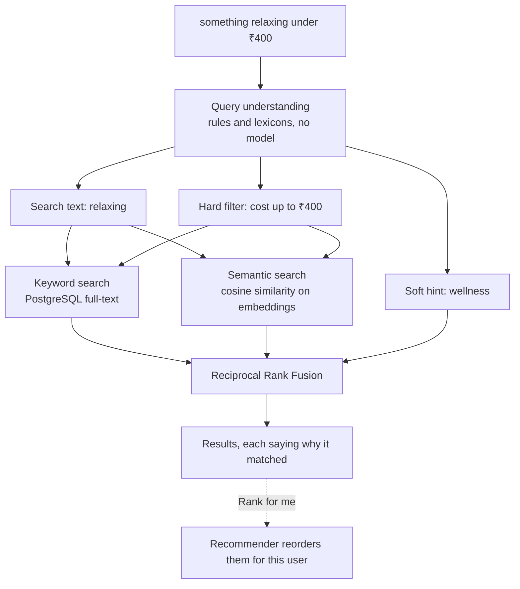
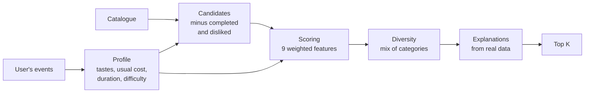
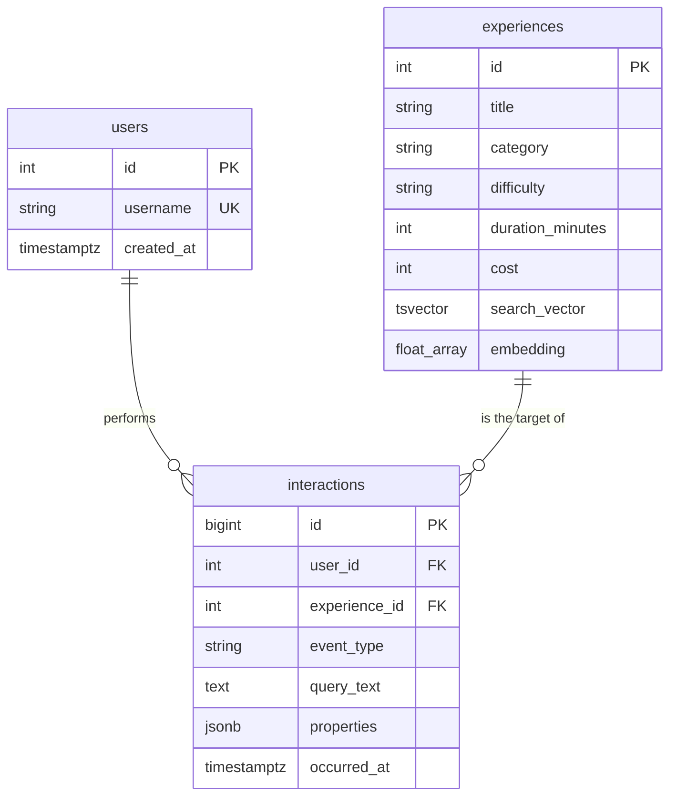

# L.I.V.E

**Learn · Interact · Venture · Experience**

[](https://github.com/AparnaBharani/L.I.V.E/actions/workflows/ci.yml)
[](LICENSE)

L.I.V.E is a full-stack discovery platform that recommends things to **do**, not things to scroll
past. Describe what you are in the mood for in your own words, act on what you find, and the
recommendations learn from what you actually did.

> Try saying *"something relaxing under ₹400"*. L.I.V.E reads the budget as a hard limit, searches
> by meaning, and shows you what it understood.

## Contents

- [Features](#features)
- [How it works](#how-it-works)
- [System architecture](#system-architecture)
- [Tech stack](#tech-stack)
- [Getting started](#getting-started)
- [Five-minute demo](#five-minute-demo)
- [Results](#results)
- [Testing](#testing)
- [Project structure](#project-structure)
- [Documentation](#documentation)
- [Limitations and next steps](#limitations-and-next-steps)

## Features

| Feature | What it means for the user |
|---|---|
| **Natural-language search** | Type a sentence. Budget, time and difficulty are picked out and enforced, and shown on screen. |
| **Search by meaning** | "ceramics" finds a pottery class even though they share no words. |
| **Personalised recommendations** | Ranked from what you saved, liked, completed and skipped. |
| **Explanations you can check** | "Similar to Beginner pottery wheel class, which you saved" always names something real. |
| **Honest cold start** | New users see popular picks, clearly labelled as not personalised yet. |
| **Full history** | Every action is stored in an append-only log, and you can browse all of it. |

## How it works

Every action feeds the next recommendation:



Three ideas shape the design:

1. **The event log is the source of truth.** Actions are appended, never edited. Whether something
   is "saved" is worked out by replaying the log, so history is never lost.
2. **Retrieval and ranking are separate.** Search decides what *may* appear. The recommender decides
   the order *for this person*. Either can change without touching the other.
3. **Simple and measured comes first.** Each AI component had to justify itself. An LLM was left out
   because its value could not be measured without real users
   ([reasoning](docs/AI_PIPELINE.md#why-there-is-no-llm)).

## System architecture

L.I.V.E is a modular monolith: one frontend, one API and one database, with clear boundaries inside.



| Layer | Responsibility | Where |
|---|---|---|
| Pages and components | Show data and capture actions | `frontend/app`, `frontend/components` |
| API client | The only code that calls the backend | `frontend/lib/api.ts` |
| Routers | HTTP only: routes, status codes, errors | `backend/app/routers` |
| Schemas | Validate input and shape output | `backend/app/schemas.py` |
| Search | Understand a query and find candidates | `backend/app/search` |
| Recommender | Rank candidates for a person and explain why | `backend/app/recommender` |
| Models and migrations | Tables, constraints and schema history | `backend/app/models.py`, `backend/alembic` |

### What happens during a search



If the model cannot load, search keeps working with keywords and tells the user.

### How recommendations are made



Each stage is a plain function with no database access, so the offline evaluation runs exactly the
same code as the live API.

### Data model



## Tech stack

| Area | Tools | Why |
|---|---|---|
| Frontend | Next.js 16, React 19, TypeScript, Tailwind CSS | Typed components and file-based routing |
| Backend | Python 3.13, FastAPI, Pydantic | Validation and API docs generated from type hints |
| Database | PostgreSQL, SQLAlchemy 2, Alembic | Enforced relationships, full-text search and versioned migrations |
| Search | PostgreSQL full-text search, fastembed, NumPy | Hybrid search with no separate search service |
| Testing | pytest, Playwright, GitHub Actions | Backend, browser and CI coverage |

**Technology left out on purpose:** pgvector and vector databases, because scanning a small catalogue
is instant. An LLM, because its value cannot be measured yet. PyTorch, because the model runs on
ONNX. Microservices, because one team and one API do not need them.

## Getting started

**You need:** Python 3.13, Node.js 22 and PostgreSQL 16 or newer.

### 1. Create the database

```sql
CREATE DATABASE live_db;
```

### 2. Start the backend

```powershell
cd backend
python -m venv venv
.\venv\Scripts\Activate.ps1            # macOS/Linux: source venv/bin/activate
pip install -r requirements-dev.txt
copy .env.example .env                 # macOS/Linux: cp .env.example .env
```

Edit `backend/.env` with your PostgreSQL password. If it contains special characters, URL-encode
them, for example `@` becomes `%40`.

```powershell
alembic upgrade head                   # create the tables
python -m scripts.seed                 # add demo users, experiences and history
python -m scripts.embed_experiences    # add vectors (downloads about 70 MB once)
uvicorn app.main:app --reload
```

The API runs at <http://127.0.0.1:8000>, with interactive docs at
<http://127.0.0.1:8000/docs>.

### 3. Start the frontend

In a second terminal:

```powershell
cd frontend
npm install
npm run dev
```

Open <http://localhost:3000>.

## Five-minute demo

1. Pick `demo_outdoor_maya`, then `demo_creative_lena`. Each sees different recommendations.
2. Click the example **ceramics**. It finds pottery with no shared words.
3. Click **something relaxing under ₹400**. The budget is shown and enforced.
4. Click **Rank for me** to reorder the results for the current user.
5. Pick `demo_coldstart_ella`. She sees popular picks, labelled as not personalised.
6. As Ella, save and like a few things. The section becomes personalised, with reasons.
7. Open **My history** to see every action as stored.

To restore the demo: `python -m scripts.seed --reset`.

## Results

> **Read this first.** These numbers use synthetic data and labels written by the developer, and some
> settings were chosen on the same data. They compare methods with each other. They do **not** show
> how well L.I.V.E works for real people.

**Search** (24 hand-labelled queries):

| Method | Recall@5 | MRR |
|---|---|---|
| Keyword only | 0.514 | 0.576 |
| Semantic only | 0.979 | 1.000 |
| Hybrid | 0.979 | 0.958 |

Semantic search is the clear gain. Hybrid did not beat it here. It stays because keywords handle exact
names and keep search working if the model fails.

**Recommendations** (11 users, 2 held-out items each, top 5):

| Method | Recall@5 | NDCG@5 | Categories in top 5 |
|---|---|---|---|
| Random | 0.141 | 0.106 | 3.74 |
| Popularity | 0.091 | 0.046 | 3.09 |
| Rules only (baseline) | 0.409 | 0.378 | 3.82 |
| **Current** | **0.500** | **0.409** | 3.27 |

Reproduce these with `python -m scripts.evaluate` and `python -m scripts.evaluate_search`. The method
and caveats are in the [AI pipeline guide](docs/AI_PIPELINE.md).

## Testing

| Suite | Tests | Command |
|---|---|---|
| Backend: schemas, API, database, search, recommender | 431 | `cd backend; pytest` |
| Browser: full user journeys in Chromium | 34 | `cd frontend; npm run test:e2e` |
| Frontend static checks | | `npm run lint`, `npx next typegen; npx tsc --noEmit`, `npm run build` |

Stop your dev servers before running browser tests. Playwright starts its own and refuses to reuse a
running one, because a dev server is connected to your real data.

**Your development data is protected.** Tests never touch `live_db`:

| Database | Used by | Lifetime |
|---|---|---|
| `live_db` | The app in development | Permanent |
| `live_db_test` | pytest | Rebuilt every run |
| `live_db_e2e` | Playwright | Rebuilt every run |

[GitHub Actions](.github/workflows/ci.yml) runs all of this on every pull request.

## Project structure

```text
L.I.V.E/
├── backend/
│   ├── app/
│   │   ├── routers/        HTTP endpoints
│   │   ├── search/         query understanding and hybrid retrieval
│   │   ├── recommender/    profile, candidates, scoring, ranking, explanations
│   │   ├── models.py       database tables
│   │   └── schemas.py      request and response shapes
│   ├── alembic/            database migrations
│   ├── scripts/            seed data, embeddings and evaluation
│   └── tests/              backend tests
├── frontend/
│   ├── app/                pages
│   ├── components/         UI and data hooks
│   ├── lib/                API client, event helpers and types
│   └── e2e/                browser tests
├── docs/                   detailed guides
└── render.yaml             deployment blueprint
```

## Documentation

| Guide | Read it for |
|---|---|
| [AI pipeline](docs/AI_PIPELINE.md) | How search, ranking and explanations work, with the evaluation in full |
| [Development guide](docs/DEVELOPMENT.md) | The full API reference, event model, migrations, seed data and tests |
| [Deployment guide](docs/DEPLOYMENT.md) | Hosting steps, environment variables and troubleshooting |
| [Product vision](docs/VISION.md) | Why L.I.V.E exists |

## Limitations and next steps

**This is a demo, so please don't deploy it publicly with real data.** There is no login, so anyone
can act as any user, and there is no rate limiting.

- Recommendation quality has not been tested with real people.
- Ranking weights are hand-set, because learning them needs real interaction data.
- Query understanding is rule-based, with no spelling correction or general negation.
- Every recommendation request scores the whole catalogue, which suits a small catalogue only.

**Next:** authentication, then real usage data, then learned ranking and an LLM where measurements
show they help.

## License

[MIT](LICENSE) © 2026 Aparna Bharani
